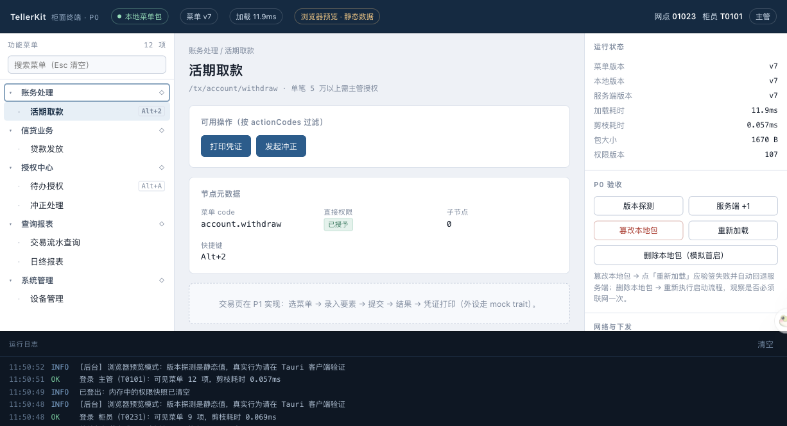

# TellerKit

柜面终端客户端。目标形态是「主壳 + 基础菜单 + 可插拔业务包 + 服务端授权」。

当前进度：**P0 已完成**（骨架 + 菜单权限闭环，53 个 Rust 测试 + 6 项人工验收）。
下一步是 P1：交易框架 + 设备抽象 mock。

---

## 它解决什么问题

传统柜面客户端每次启动都要拉菜单、再解析、再按权限过滤，首屏被网络往返拖住。
TellerKit 把菜单树做成**本地签名的二进制包**，启动时只做「读文件 → 验签 → 内存剪枝」，
网络降级为渲染之后的版本探测：

```
启动 ─┬─ 读 .mtree (≤5ms) ─ 验签 (≤10ms) ─ 反序列化 ─ 权限剪枝 (<1ms) ─ 渲染
      └─ 渲染之后：版本探测（<1KB）→ 不一致才静默下载
```

---

## 目录结构

```
TellerKit/
├── crates/
│   ├── tellerkit-core/       # 纯逻辑，无 GUI 依赖，可独立 cargo test
│   │   ├── model.rs          # MenuNode / MenuTree 契约与结构校验
│   │   ├── filter.rs         # filter_visible()：权限剪枝（唯一规则）
│   │   ├── pack.rs           # .mtree 编解码 + Ed25519 签名/验签
│   │   ├── store.rs          # 本地包仓库：原子替换、版本保留、验签失败检测
│   │   ├── perm.rs           # PermSnapshot
│   │   ├── sync.rs           # 启动回退 / 版本探测编排（可测，无 GUI 依赖）
│   │   └── mock.rs           # mock 服务端：版本探测、下发、三角色、演示树
│   └── mtree-tool/           # CLI：造包 / 验签 / 查看（模拟服务端构建环节）
├── src-tauri/                # Tauri 主壳，持有 AppState（唯一真相源）
│   └── src/
│       ├── lib.rs            # AppState + 启动装配
│       └── commands.rs       # boot / login / logout / check_update / dev_*
├── src/                      # Vue 3 前端，只渲染，不做权限判断
│   ├── contracts.ts          # 与 Rust serde 逐字段对齐的类型
│   ├── api.ts                # invoke 薄封装（无 Tauri 时退到 mockBackend）
│   ├── mockBackend.ts        # 浏览器预览适配层（只搬运 fixture，不重算权限）
│   ├── fixtures/             # 由 `npm run fixtures` 用真实核心逻辑导出
│   └── App.vue               # 布局 + 键盘漫游 + 日志
├── docs/
│   ├── PLAN.md               # 诉求梳理与 P0–P3 路线
│   ├── security-boundary.md  # 安全边界（对外统一话术）
│   └── adr/                  # 5 条架构决策记录
└── scripts/verify-p0.sh      # P0 自动化验收
```

---

## 界面

**登录（三角色）**


**柜员：只能看到自己有权访问的 9 个节点**


**主管：父分组无权但仍作为容器保留（◇），下挂有权的子菜单**



## 快速开始

```bash
npm install
npm run tauri:dev        # 开发模式（Vite + Tauri）
```

> 裸的 `target/debug/tellerkit` 默认会去找 dev server。要单独运行可执行文件，
> 需把前端嵌进二进制：`cargo build -p tellerkit --features custom-protocol`。
> 出包走 `npm run tauri:build`（CLI 会自动加这个 feature）。

首次启动会从 mock 服务端拉一次菜单包，装到应用数据目录：

```
~/Library/Application Support/com.tellerkit.demo/menu/menu.7.mtree
```

之后断网也能启动。

### 只用命令行验证核心逻辑

```bash
cargo test --workspace             # 53 个测试：过滤、验签、篡改、原子替换、回滚、启动回退
bash scripts/verify-p0.sh          # P0 验收（含真实文件篡改）
```

### 只迭代界面（不启动 Tauri）

```bash
npm run fixtures     # 用真实核心逻辑导出 fixtures
npm run dev          # 浏览器打开 http://localhost:1420
```

此时顶部会显示「浏览器预览 · 静态数据」。菜单剪枝结果来自 Rust，不是前端重算的；
但验签、版本探测、会话生命周期必须在 `npm run tauri:dev` 里验证。

### 造包 / 验签

```bash
cargo run -p mtree-tool -- pubkey
cargo run -p mtree-tool -- inspect ~/Library/Application\ Support/com.tellerkit.demo/menu/menu.7.mtree
cargo run -p mtree-tool -- verify  ~/Library/Application\ Support/com.tellerkit.demo/menu/menu.7.mtree
```

私钥来自公开的 `DEMO_SEED`（`crates/tellerkit-core/src/mock.rs`），**只能用于演示**。
生产环境私钥只存在于服务端构建环节，客户端只内置公钥。

---

## P0 验收（手动）

界面上右侧「P0 验收」面板就是为这六条准备的：

| # | 验收项 | 操作 | 期望 |
|---|---|---|---|
| 1 | 断网冷启动 | 勾「模拟断网」→ 退出重启 | 3 秒内出登录页，顶部显示「本地菜单包」 |
| 2 | 三角色三套菜单 | 分别以柜员 / 主管 / 大堂经理登录 | 菜单结构明显不同；柜员看不到「授权中心」 |
| 3 | 父无权子有权 | 以主管登录 | 「账务处理」分组显示为容器（◇），下仅有「活期取款」 |
| 4 | 篡改即失效 | 点「篡改本地包」→「重新加载」 | 日志显示「本地菜单包验签失败…已回退服务端」，菜单版本不变 |
| 5 | 换号不残留 | 登出 → 换另一个角色登录 | 不出现上一个角色的菜单项 |
| 6 | 权限剪枝耗时 | 观察右栏「剪枝耗时」 | < 1ms 量级 |

---

## 当前**没有**做的（别误以为有）

- 真实后端、真实登录、真实交易（P1）
- 外设驱动（P1 起做 mock trait，P3 真机）
- 业务包 `.bizpkg`（P2）
- 离线交易队列、冲正状态机、更新器、水印锁屏（P3）
- WebView2 离线部署验证（P2 前必须做，否则银行内网装不上）

---

## 文档

- [诉求与计划](docs/PLAN.md)
- [安全边界](docs/security-boundary.md)
- [ADR-0001 框架选型](docs/adr/0001-tauri-as-shell.md)
- [ADR-0002 全量树 + 快照](docs/adr/0002-full-tree-plus-snapshot.md)
- [ADR-0003 .mtree 签名包](docs/adr/0003-mtree-signed-binary.md)
- [ADR-0004 借鉴 GPUI](docs/adr/0004-borrow-gpui-not-adopt.md)
- [ADR-0005 快照生命周期](docs/adr/0005-snapshot-lifecycle.md)
