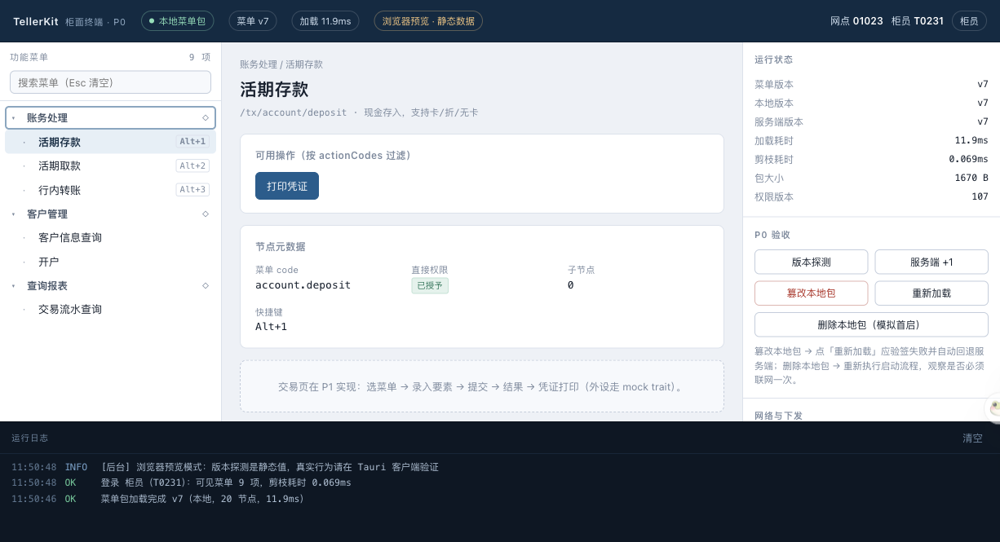

# TellerKit

[](https://github.com/open-banking-labs/tellerkit/actions/workflows/gate.yml)
[](LICENSE)

银行柜面终端客户端。主壳 + 基础菜单 + 可插拔业务包。
**账务、账户、授权都在远端核心系统；桌面端只负责终端行为与断网处置。**



*柜员登录后只看到有权的 9 个节点；版本、剪枝耗时、包大小都是启动时真实测量的。*

## 为什么值得这么做

传统柜面客户端每次启动先拉菜单、再解析、再按权限过滤，首屏被网络往返拖住，断网就废了。

TellerKit 把菜单树做成**本地签名的二进制包**，启动路径上没有任何网络调用：

```
读 .mtree (≤5ms) → 验签 (≤10ms) → 反序列化 → 权限剪枝 (<1ms) → 渲染
                                                    ↓
                                      渲染之后才做版本探测（<1KB）
```

断网照样启动；包被改一个字节就拒绝加载并回退上一版。

## 现在有什么

| 能力 | 状态 | 代码 |
|---|---|---|
| 菜单包：签名、原子替换、版本回退 | 完成 | `packages/core/src/{pack,store,sync}.rs` |
| 权限剪枝（后端算，前端只渲染） | 完成 | `packages/core/src/filter.rs` |
| 交易：提交 / 挂起 / 重放 / 状态不明标记待冲正 | 完成 | `packages/core/src/{tx,replay}.rs` |
| 冲正：两阶段确认，主管授权，自批拦截 | 完成 | `packages/core/src/reversal.rs` |
| 业务包：独立签名容器 + iframe 沙箱 | 完成 | `pkg.rs`、`src/platform/sandbox.ts` |
| 远端通信：HTTP/TCP × JSON/定长报文，主备切换 | 完成 | `remote.rs`、`packages/transport-net` |
| 审计（只增）、日终对账、锁屏水印、更新策略 | 完成 | `journal-sqlite`、`session.rs`、`update.rs` |
| 四类外设（打印/读卡/密码键盘/扫描） | 接口完成，真机未接 | `packages/core/src/device.rs` |
| 更新执行器（下载/验签/原子替换） | 策略完成，执行器未接 | `packages/core/src/update.rs` |


*提交 → 四态结果 → 打印凭证；超时且状态不明时给「标记待冲正」，不猜成败。*

**上不了生产的 8 个原因在 [docs/production-readiness.md](docs/production-readiness.md)**——
多数不是代码问题（服务端幂等未联调、IAM、真机、签名私钥保管）。

## 跑起来

```bash
npm install
npm run dev                # 浏览器预览，静态数据；改界面用这个
npm run tauri:dev          # 真实窗口；验签/会话/设备必须在这里验
npm run gate               # 本地静态预检（见下方说明）
```

`gate` = 八道静态检查（层级边界 / 契约一致 / 任务结构 / AI 规则 / 轨迹留痕 / 银行名称 / 版本一致 /
模块深度 strict 基线）+ `cargo fmt --check`。模块深度按 `tools/module-depth-baseline.json` 只拦新增回归。
提交前另有 `.githooks/pre-commit` 只跑银行名称这一道；安装：`git config core.hooksPath .githooks`。

**裁决口径**：`npm run gate` 只做静态预检，exit 0 不代表编译或测试通过。
合并裁决 = 分支保护要求的 CI checks（test / clippy / bindings / build / gate 全绿）；
CI 还检查 `contracts/**` 有变更时必须新增 `changes/*.md` 提案。
本机按编译纪律不跑 cargo，完整结论看 CI。理由见 [changes/018-adjudication.md](changes/018-adjudication.md)。

首次启动会用 mock 服务端拉一个菜单包，之后断网可启动：

```
~/Library/Application Support/com.tellerkit.demo/menu/menu.7.mtree
```

> 编译不在本机跑，走构建机。原因和各平台验证方式见 [AGENTS.md](AGENTS.md)。

## 结构

四层，依赖单向：

```
L1 界面   apps/shell/src          Vue 3，只渲染
L2 IPC    src-tauri/commands.rs   只做参数映射，不写业务
L3 用例   src-tauri/app.rs        ShellApp 编排
L4 领域   packages/core           纯 Rust，无 GUI / DB / 网络依赖
```

为什么这么切、三条边界（桌面内部 / IPC / 桌面↔远端）怎么划，
见 [docs/architecture.md](docs/architecture.md)。

## 文档

给人读的，按需取：

| 文档 | 什么时候读 |
|---|---|
| [docs/architecture.md](docs/architecture.md) | 要改结构、加抽象层 |
| [docs/desktop-scope.md](docs/desktop-scope.md) | 不确定某段逻辑该在端上还是远端 |
| [docs/security-boundary.md](docs/security-boundary.md) | 对外讲安全，或评审边界 |
| [docs/production-readiness.md](docs/production-readiness.md) | 上线前逐条核对 |
| [docs/reviews/scale-readiness-review-2026-11-25.md](docs/reviews/scale-readiness-review-2026-11-25.md) | 按大型银行生产规模推演整改，排期与验收用 |
| [docs/project-backlog.md](docs/project-backlog.md) | 项目级整改总台账：先去重，再按信任/资金/交付排序 |
| [docs/reviews/architecture-review-backlog.md](docs/reviews/architecture-review-backlog.md) | 架构评审的 29 条细项与验收标准 |
| [docs/ui-ux-backlog.md](docs/ui-ux-backlog.md) | 主壳产品化细项（19 条 + 7 个阻塞） |
| [docs/ai-leverage-backlog.md](docs/ai-leverage-backlog.md) | AI 杠杆与证据链细项 |
| [docs/PLAN.md](docs/PLAN.md) | 想看最初诉求与路线 |
| [CHANGELOG.md](CHANGELOG.md) | 版本变更记录（版本唯一来源见 `Cargo.toml`） |

规模数字不手抄：`npm run stats`。

## 贡献

**AI 从 [AGENTS.md](AGENTS.md) 开始，不要从本文件开始。** 那里有只读区、9 条禁令和
逐级下发的阅读顺序：根 `AGENTS.md` → `docs/constitution.md` → 目标目录最近的 `AGENTS.md`
→ 该目录 `README.md`。规则只写一处，本文件不重复。

人：改动走 PR，CI required checks 全绿才能合并（`gate` 只是静态预检）；要改契约先写 `changes/` 提案。

## 许可

Apache-2.0
