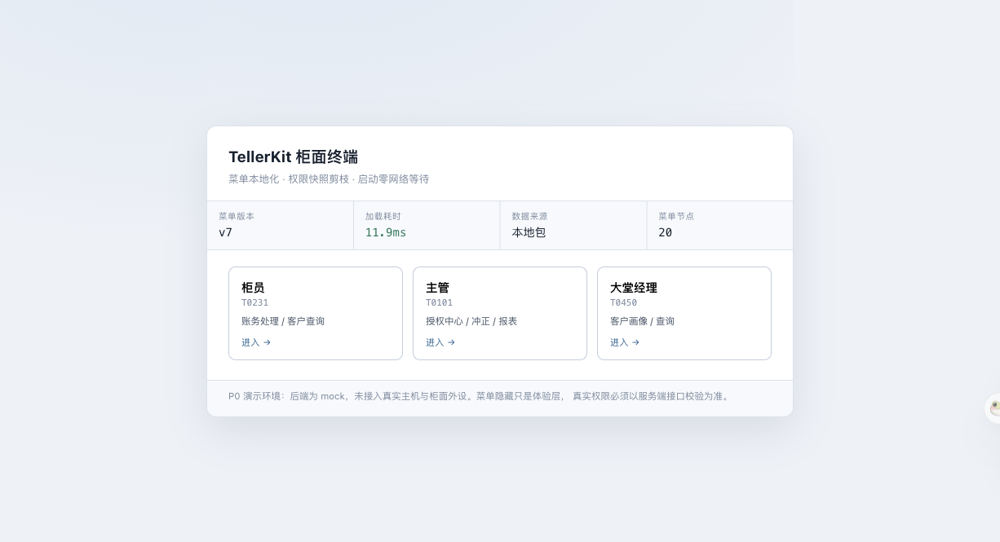
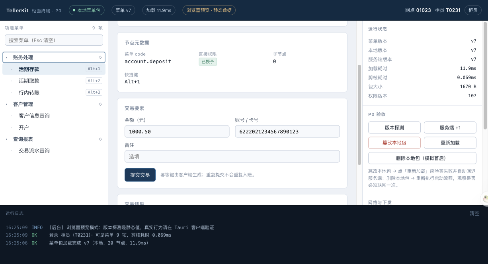

# TellerKit

[](https://github.com/open-banking-labs/tellerkit/actions/workflows/gate.yml)
[](https://tauri.app)
[](https://github.com/open-banking-labs/tellerkit)

柜面终端客户端。目标形态是「主壳 + 基础菜单 + 可插拔业务包 + 服务端授权」。

当前进度：**P0 已完成**（菜单权限闭环，53 个 Rust 测试 + 6 项人工验收）；
仓库已迁到生产级团队形态（`apps/` + `packages/` + `contracts/` + `.specify/` + `.agents/`）。
下一步是 **W2：契约即代码**——由 Rust 生成 TS 类型，消灭手写 `contracts.ts`。

---

## 它解决什么问题

传统柜面客户端每次启动都要拉菜单、再解析、再按权限过滤，首屏被网络往返拖住。
TellerKit 把菜单树做成**本地签名的二进制包**，启动时只做「读文件 → 验签 → 内存剪枝」，
网络降级为渲染之后的版本探测：

```
启动 ─┬─ 读 .mtree (≤5ms) ─ 验签 (≤10ms) ─ 反序列化 ─ 权限剪枝 (<1ms) ─ 渲染
      └─ 渲染之后：版本探测（<1KB）→ 不一致才静默下载
```

---

## 目录结构

```
TellerKit/
├── apps/
│   └── shell/                    # 柜面客户端主壳
│       ├── src/                  # Vue 3，只渲染
│       │   └── generated/        # 由 Rust 生成的类型（勿手改）
│       ├── src-tauri/            # AppState + IPC 命令
│       └── dist/                 # 构建产物
├── packages/
│   ├── core/                     # 纯 Rust 引擎，无 GUI 依赖，53 个测试
│   │   ├── model.rs              # 菜单契约与结构校验
│   │   ├── filter.rs             # filter_visible 递归剪枝
│   │   ├── pack.rs               # .mtree 编解码 + Ed25519
│   │   ├── store.rs              # 原子替换 / 版本保留 / 坏包拒绝
│   │   ├── sync.rs               # 启动回退 / 版本探测
│   │   └── mock.rs               # mock 服务端：三角色
│   └── biz-demo/                 # 业务包骨架（P2 加载）
├── tools/                        # 门禁 + 造包 CLI
│   ├── paths.mjs                 # 按目录发现，不写死路径
│   ├── check-boundaries.mjs
│   ├── check-contracts.mjs
│   ├── check-ai-rules.mjs
│   ├── gen-bindings.mjs          # Rust → TS 类型与命令名
│   └── mtree-tool/               # 造包 / 验签 / fixtures
├── contracts/                    # 唯一事实源（只读）
├── .specify/                     # 规格层
├── .agents/                      # Agent 角色预设（4 份）
├── changes/                      # 契约变更提案
├── docs/
│   ├── PLAN.md                   # 诉求梳理与路线
│   ├── constitution.md           # 项目宪法（10 条）
│   ├── team.md                   # 团队分工（AI 主力）
│   ├── metrics.md                # 指标定义与"变了该做什么" 
│   ├── security-boundary.md      # 安全边界与对外话术
│   └── adr/                      # 6 条架构决策
└── scripts/verify-p0.sh
```

---

## 界面

**登录（三角色）**



**柜员：只能看到自己有权访问的 9 个节点**


**主管：父分组无权但仍作为容器保留（◇），下挂有权的子菜单**


**交易面板（P1.3）：录入要素 → 提交 → 三态结果 → 打印凭证**



## AI 约束与门禁

这个仓库由人 + AI 共同维护，所以规则必须能被执行，而不只是写在文档里。

### 规则在哪

| 层 | 文件 | 作用 |
|---|---|---|
| 全局 | [docs/constitution.md](docs/constitution.md) | 10 条不可协商原则，每条标注"靠什么检查" |
| 根 | [AGENTS.md](AGENTS.md) | 只读区 + 8 条禁令 + 入口导航（40 行，短到会被读完） |
| 目录 | `crates/tellerkit-core/`、`src-tauri/`、`src/` 各一份 | 职责边界、允许依赖、禁止事项、测试命令 |
| 契约 | [contracts/](contracts/README.md) | 接口/字段/错误码唯一事实源，**只读** |
| 规格 | [.specify/](.specify/README.md) | 行为规格，AI 可起草不可改验收标准 |
| 团队 | [docs/team.md](docs/team.md) + [.agents/presets/](.agents/README.md) | 六个角色、四个决策点、每个角色的门禁 |

### 契约即代码

前端类型不是手写的：Rust 结构体上标 `#[ts(export)]`，`cargo test` 时导出到
`apps/shell/src/generated/`；命令名由 `generate_handler!` 生成 `CommandName` 联合类型。

```bash
npm run bindings    # 改完 Rust 必须跑这一步
```

于是：拼错命令名是**编译错误**（不是运行时 `command not found`）；
手改生成物会被 `manifest.json` 的 hash 拦下；漏更新会被三方比对拦下。

### 门禁（唯一裁决入口）

```bash
npm run gate
```

| 门禁 | 拦什么 | 真实拦到过的例子 |
|---|---|---|
| `check-boundaries` | 前端推导权限、core 依赖 tauri、命令层 `unwrap()` | `src/mockBackend.ts` 注释里出现 `filter_visible` |
| `check-contracts` | 契约、Rust、生成物三方不一致；手改生成物 | 手改 `generated/LoginResult.ts`、偷加 `UpdateReport` 字段 |
| `check-tasks` | `tasks.md` 结构、场景引用、覆盖率 | 引用了不存在的场景、场景无人覆盖 |
| `check-ai-rules` | 文档缺失、调试残留、端侧 AI 偷偷实现 | `src/App.vue` 里的 `console.log` |

**三条硬规矩**：AI 不改 `contracts/`（要改先写 `changes/` 提案）；AI 不能自称"测试通过"（只认 exit code）；
AI 只在 8 步流程的第 3–5 步工作（规格定义和批准合并是人的职责）。

## 团队：AI 主力

六种角色、四个由人保留的决策点，详见 [docs/team.md](docs/team.md)。

| 角色 | 谁 | 产出 | 由谁裁决 |
|---|---|---|---|
| 项目负责人 | 人 | 规格、批准契约、合并、发布 | — |
| Lead Agent | AI | 拆任务、派发、提案 | 人评审 |
| Schema Agent | AI | 业务包元数据 | `check-ui-schema`（P2） |
| Engine Agent | AI | Rust/TS 实现 | `check-boundaries` + `cargo test` |
| Test Agent | AI | 契约测试 | 场景覆盖率 |
| Review Agent | AI | 评审摘要 | 人 |

角色定义在 [.agents/presets/](.agents/README.md)，W4 接到 DSH 的 subagent preset。

## 快速开始

```bash
npm install
npm run tauri:dev        # 开发模式（Vite + Tauri），在 apps/shell 内运行
```

根目录是 npm workspaces 的 workspace 根；`npm run <script>` 会转发到 `apps/shell`。

> 裸的 `target/debug/tellerkit` 默认会去找 dev server。要单独运行可执行文件，
> 需把前端嵌进二进制：`cargo build -p tellerkit --features custom-protocol`。
> 出包走 `npm run tauri:build`（CLI 会自动加这个 feature）。

首次启动会从 mock 服务端拉一次菜单包，装到应用数据目录：

```
~/Library/Application Support/com.tellerkit.demo/menu/menu.7.mtree
```

之后断网也能启动。

### 只用命令行验证核心逻辑

```bash
cargo test --workspace             # 53 个测试：过滤、验签、篡改、原子替换、回滚、启动回退
bash scripts/verify-p0.sh          # P0 验收（含真实文件篡改）
```

### 只迭代界面（不启动 Tauri）

```bash
npm run fixtures     # 用真实核心逻辑导出 fixtures
npm run dev          # 浏览器打开 http://localhost:1420
```

此时顶部会显示「浏览器预览 · 静态数据」。菜单剪枝结果来自 Rust，不是前端重算的；
但验签、版本探测、会话生命周期必须在 `npm run tauri:dev` 里验证。

### 造包 / 验签

```bash
cargo run -p mtree-tool -- pubkey
cargo run -p mtree-tool -- inspect ~/Library/Application\ Support/com.tellerkit.demo/menu/menu.7.mtree
cargo run -p mtree-tool -- verify  ~/Library/Application\ Support/com.tellerkit.demo/menu/menu.7.mtree
```

私钥来自公开的 `DEMO_SEED`（`crates/tellerkit-core/src/mock.rs`），**只能用于演示**。
生产环境私钥只存在于服务端构建环节，客户端只内置公钥。

---

## P0 验收（手动）

界面上右侧「P0 验收」面板就是为这六条准备的：

| # | 验收项 | 操作 | 期望 |
|---|---|---|---|
| 1 | 断网冷启动 | 勾「模拟断网」→ 退出重启 | 3 秒内出登录页，顶部显示「本地菜单包」 |
| 2 | 三角色三套菜单 | 分别以柜员 / 主管 / 大堂经理登录 | 菜单结构明显不同；柜员看不到「授权中心」 |
| 3 | 父无权子有权 | 以主管登录 | 「账务处理」分组显示为容器（◇），下仅有「活期取款」 |
| 4 | 篡改即失效 | 点「篡改本地包」→「重新加载」 | 日志显示「本地菜单包验签失败…已回退服务端」，菜单版本不变 |
| 5 | 换号不残留 | 登出 → 换另一个角色登录 | 不出现上一个角色的菜单项 |
| 6 | 权限剪枝耗时 | 观察右栏「剪枝耗时」 | < 1ms 量级 |

---

## 当前**没有**做的（别误以为有）

- 真实后端、真实登录、真实交易（P1）
- 外设驱动（P1 起做 mock trait，P3 真机）
- 业务包 `.bizpkg`（P2）
- 离线交易队列、冲正状态机、更新器、水印锁屏（P3）
- WebView2 离线部署验证（P2 前必须做，否则银行内网装不上）

---

## 许可证

[Apache License 2.0](LICENSE) © 2026 Open Banking Labs

含专利授权条款，适合机构与商业场景使用。使用时请保留 `LICENSE` 与版权声明。

## 文档

- [诉求与计划](docs/PLAN.md)
- [安全边界](docs/security-boundary.md)
- [ADR-0001 框架选型](docs/adr/0001-tauri-as-shell.md)
- [ADR-0002 全量树 + 快照](docs/adr/0002-full-tree-plus-snapshot.md)
- [ADR-0003 .mtree 签名包](docs/adr/0003-mtree-signed-binary.md)
- [ADR-0004 借鉴 GPUI](docs/adr/0004-borrow-gpui-not-adopt.md)
- [ADR-0005 快照生命周期](docs/adr/0005-snapshot-lifecycle.md)
