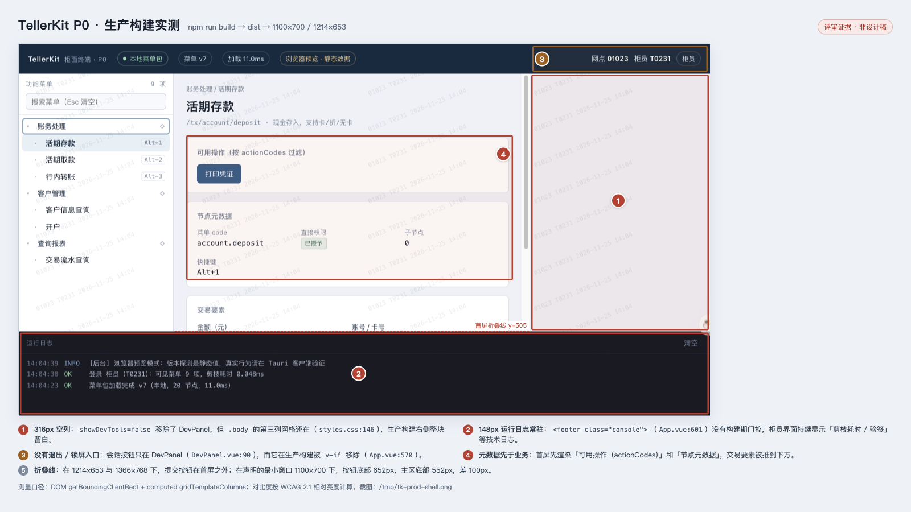

# TellerKit 柜面终端 · UI/UX 评审

- 日期：2026-11-25
- 对象：`apps/shell` 的 P0 主壳（Vue 3 + Tauri 2），含生产构建实测
- 方法：读 UI 源码/样式；`npm run build` + `vite preview`；Chromium 实测 1214×653、1100×700、1366×768；DOM 尺寸与 WCAG 2.1 对比度计算
- 约束：本轮只评审，不改业务代码；`contracts/**`、`docs/adr/**`、`docs/constitution.md` 未动

> 结论先行：**内核是产品级的，主壳还是演示级的。**
> 菜单包、权限剪枝、交易四态、冲正授权、审计与对账在 Rust 侧已经闭环；
> 但界面把"系统怎么工作"摆在了柜员面前，把"柜员要做什么"推到了后面。
> 生产构建甚至会留下 316px 空列和 148px 技术日志，同时没有退出/锁屏入口。



---

## 1. 做得好的地方

1. **离线优先被诚实表达**。顶栏「本地菜单包」绿点 + 菜单版本，比"启动成功"有用。
2. **权限剪枝结果由后端给，前端只渲染**。菜单里看不到不是 CSS 藏的，边界干净。
3. **交易不是二元的**。`committed / pending / rejected / marked_for_reversal` 四态，加上"不猜成败"的文案，是最有价值的产品判断（`TxPanel.vue:26-31`）。
4. **视觉克制**。海军蓝 + 灰蓝 + 语义色，密度适合柜面，没有为了"现代化"加渐变和多余动效。
5. **键盘不是事后补的**。`Alt+N`、方向键、Enter、Esc 已能完成菜单导航（`App.vue:251-311`）。

改版方向不是推翻这套气质，而是**把柜员任务放回视觉中心**。

---

## 2. 关键发现

严重度：**P0** 影响"能不能给网点看/试点"的正确性与信任；**P1** 影响效率/可访问性/异常处置；**P2** 打磨。

### P0-1 · 生产构建留白 316px，且没有退出/锁屏入口

`showDevTools = !import.meta.env.PROD`（`App.vue:31`）移除了 DevPanel（`App.vue:570`），但 `.body` 三列网格写死（`styles.css:146`）：

```css
grid-template-columns: 272px minmax(0, 1fr) 316px;
```

生产实测：1214×653 主区 626px，`272px 626px 316px`，右侧空 316px（26%）；1100×700 主区仅 512×500，空列 29%。`<footer class="console">`（`App.vue:601-614`）没有构建期门控，148px"运行日志"随生产包上线。顶栏无退出，`logoutBtn: []`；唯一登出在 DevPanel（`DevPanel.vue:90`），已被移除。

**影响**：网点看到"右边一大块空白 + 底部技术日志 + 找不到退出"。这是产品形态问题，不是配色问题。

**建议**：`.body` 默认两列，渲染 rail 时才加第三列；顶栏加 `锁屏 / 切换柜员 / 退出 / 关于`；console、节点元数据、版本耗时收进默认关闭的"诊断"抽屉；加 1100×700 截图回归。

### P0-2 · 首屏先给元数据，交易表单在折叠线以下

主区顺序是"可用操作 → 节点元数据 → 交易要素"（`App.vue:525-564`）。实测：

- 1100×700：主区高 500px，表单顶部 488px，提交按钮底部 652px，**在主区底部以下 100px**
- 1214×653：主区底部 505px，只露出"金额/账号"两个标签
- 1366×768：按同一布局，主区底部 620px，提交按钮底部 652px，仍在折叠线下
- 默认 1360×860 勉强放得下，但这不是柜面机最常见分辨率

**影响**：柜员登录后先看到 `account.deposit`、`actionCodes`、`已授予`，再滚动找金额框。熟练柜员每天重复几十次，新柜员不知道点哪。

**建议**：操作员模式表单第一，权限/路由/节点移入抽屉；交易页用"标题 + 一句说明 + 表单 + 固定操作条"，提交条贴 main 底部。

### P0-3 · 成功后连点就是一笔新交易

`TxPanel.vue:57-85`：成功后 `result` 保留，但金额/账号/备注不清空，按钮仍可用；每次提交都 `idempotencyKey: crypto.randomUUID()`（`:65`）；提示却写"重复提交不会重复入账"（`:131`）。实测提交 1000.50 成功后，三个字段原样保留，按钮可再点，第二击会生成新幂等键。B1 明确说服务端幂等尚未联调，这句承诺目前不成立。

**建议**：成功后冻结表单，主操作变 `打印凭证 / 新交易`；幂等键绑定"一次填单会话"而非"一次点击"；文案改为已证实的表述；大额加确认页（金额大写、账号掩码、交易名、网点/柜员/时间）。

### P0-4 · 金额输入会把 1,000.50 变成 1.00

`Number.parseFloat(amountYuan.value)`（`TxPanel.vue:20-24`）：`"1,000.50"` 解析为 `1`，提交 100 分。实测返回 `PREVIEW-account.deposit-100` —— **¥1.00**。`12.345` 被静默四舍五入到 12.35，账号为空也能提交。

**建议**：输入即归一化（去空格/逗号/￥），只接受 `/^\d+(\.\d{1,2})?$/`；非法时给 `aria-invalid` + 行内错误，而不是只禁用按钮；下方实时显示 `¥1,000.50` 和中文大写；账号按交易要求校验。

### P0-5 · 锁屏 = 丢单，且没有预警、没有手动锁屏

默认 `idle_timeout_secs = 180`、`lock_on_blur = true`（`packages/core/src/session.rs:41-53`）。UI 没有锁屏前提示，没有手动锁屏；锁屏唯一动作 `@reauth` 直接映射到 `logout`（`App.vue:598`），会话和填了一半的表单一起丢；文案说"请重新登录继续办理业务"（`LockScreen.vue:32`），实际是重新开始。spec 032 明确包含"解锁后的状态恢复"，UI 没实现。

**建议**：150 秒非模态提示"30 秒后锁屏"+"继续操作"；顶栏手动锁屏；锁屏页显示网点/柜员/角色/时间/原因；锁屏不销毁会话，重登恢复表单草稿；补 `role="dialog"`、`aria-modal`、焦点陷阱，底层 `inert`。

### P1-1 · "可用操作"按钮是假的，且与真按钮同名

`可用操作` 按 `actionCodes` 渲染按钮，但**没有 `@click`**（`App.vue:525-535`），只有 `:title="a"` 显示权限码。实测点"打印凭证"日志计数不变、无反馈；同一个"打印凭证"在结果卡里是真按钮（`TxPanel.vue:160-167`）。

**建议**：操作员模式删掉此卡；保留则渲染成只读权限标签，不用 primary 按钮视觉；任何可点按钮必须有 loading/成功/失败/无权限反馈。

### P1-2 · 失败恢复是死路

- 启动失败 `fatal = String(err)`，LoginView 只显示原始错误，角色按钮 `:disabled="busy || !!error"`，**没有重试**
- 启动阶段只有一个 spinner（`App.vue:468-471`），无阶段、无超时，卡住时柜员不知道等多久
- 顶栏"已断网"只在 dev 开关下出现（`App.vue:485`），真实断网要等提交失败才知道
- `run()` 把动作错误写进底部 console（`App.vue:315-325`），离点击位置很远
- 打印/重放无 try/catch（`TxPanel.vue:52-55, 87-99`），失败是未处理 Promise
- 对账/业务包直接 `String(err)`（`ReconcilePanel.vue:32`、`PackageHost.vue:46`）

**建议**：启动失败页给人话原因 + `重试` + `使用上一版` + 可复制诊断码；全局 toast + 行内状态，console 仅兜底；所有 `await api.*` 有失败分支并翻译成人话。

### P1-3 · 结果反馈太轻、太远，四态没有"下一步"

结果卡在表单下方（`TxPanel.vue:152`），1214×653 要滚动才看到；成功只有 10.5px 绿标签 + 流水号，没有金额/账号/时间；`marked_for_reversal` 用 `warn`（`:30`），与"已挂起"同级；状态不明时结果卡没有"申请冲正"，要回上面的异常列表（`:140-150`）；无 `aria-live`。

**建议**：结果作为任务区顶部 banner，`aria-live="polite"`，自动聚焦。四态四套动作：

- committed：`打印凭证 / 新交易`，金额、账号、时间、流水号齐全
- pending：`查看待重放 / 继续`，说明何时重放
- rejected：原因 + `修改重试`
- marked_for_reversal：**danger** + "请勿重复提交" + `申请冲正 / 查询流水`

结果要给"这笔钱现在在哪"的一句话，而不只是状态名。

### P1-4 · 重放、冲正、授权缺少影响面与提醒

`重放挂起交易` 调 `api.replayPending()` 全部重放，无确认/选择/金额汇总（`TxPanel.vue:134`）；异常列表只显示 key 前 12 位和 kind，没有金额/时间/账号。"状态不明"只挂在某个交易页下方，没有全局入口。主管端"待办授权"没有 badge/队列数/新申请提示（`supervisor.png`）。

**建议**：重放前确认笔数/金额合计/时间范围，支持逐笔选择；异常队列做全局入口 + 金额/时间/账号后四位；冲正结果区分"已授权/已受理/已确认"（core 的 030 已区分）；菜单加数量 badge，队列按等待时长排序。

### P1-5 · 搜索拍平层级，键盘走不通

- 搜索结果全部 `depth = 0`，只剩"·活期取款 Alt+2"，没有父级上下文
- 搜索 "zzz" 0 条时，空状态仍是"没有可见菜单：当前角色没有可访问的功能"，把"没匹配"说成"没权限"
- 实测搜"取款"后 `focusedIndex = -1`，方向键/Enter 失效；搜索框内方向键被 `onKeydown` 直接 return（`App.vue:276-279`）；`/` 不聚焦搜索框
- 菜单无 `role="tree"` / `treeitem` / `aria-expanded` / `aria-selected`
- 每个分组都带 `◇`，title 写"仅容器，无直接访问权限"（`MenuList.vue:41`），看起来像"你没权限"；"9 项"统计 `rows.length`，含 3 个分组，实际 6 个页面
- hover 设置 `focusedIndex`（`App.vue:510`），"选中"和"焦点"两个高亮同时存在

**建议**：搜索做成命令面板：`/` 或 `Ctrl+K` 聚焦，结果带父级路径、命中高亮、快捷键；上下键选择，Enter 打开，Esc 清空并归还焦点；两种空状态分开；过滤后重置焦点；补 tree 语义，装饰性 `▸/▾` 加 `aria-hidden`；hover 只做 hover，焦点只在 `:focus-visible`；分组显示子项数、不显示锁；计数改"6 项功能"。

### P1-6 · 键盘优先只做到了菜单

选中菜单后焦点仍在菜单行；从菜单到金额输入要 Tab 过 9 个菜单行 + 一个无反应的"打印凭证"，共十余次。表单不是 `<form>`，Enter 不提交；没有 skip link、没有快捷键帮助。

**建议**：选中后焦点移到任务标题/首字段；提供"跳到主内容"；表单用 `<form @submit.prevent>`，Enter 提交（或 Ctrl+Enter 防误触）；`?` 打开快捷键帮助。

### P1-7 · 对比度、字号与目标尺寸

- `--muted #7b899e` 白底 **3.55:1**，`--bg` 上约 **3.1:1**，低于正文 4.5:1；用于 `.hint`、`.route`、`.crumbs`、`.kv`、`.menu .key` 等 10.5-12px 文本
- 83 个叶子文本节点小于 12px，基础字号 13px
- 19/19 个按钮低于 44px（菜单 29-30、按钮 31-34、输入 31）；桌面 24px 最小值能过，但柜面触屏/低视力偏小
- 焦点环不一致：按钮是浏览器默认 1px 蓝环，菜单行是 2px 自定义；无 `prefers-reduced-motion`

**建议**：正文 14px、辅助 ≥12px、金额 tabular numerals 15-16px；`--muted` 调到约 `#5c6b7f`（白底约 5:1）；控件 36-40px、触屏 44px；统一 2px accent 焦点环 + 2px offset；尊重 reduced motion。

### P1-8 · 水印在关键区域失效

`stamp` 是 `computed`，无定时器（`Watermark.vue:13-19`）。实测登录时 14:00，5 分钟后仍 14:00。颜色 `rgba(15,42,67,0.09)` 在 148px 深色 console 上几乎不可见；`.watermark` z-index 40，低于锁屏 60 和对账 70（`styles.css:830-912`）——**最敏感的日终对账页反而没有水印**。

**建议**：每分钟更新（`setInterval` + 清理）；深色区域用可读浅色水印；覆盖 modal 或 modal 内复制；对账页必须可溯源。水印不能替代脱敏，账号仍应默认掩码、按需揭示。

### P1-9 · 日终对账：功能存在，入口不存在

`showReconcile` 初始 `false`，全文件没有设为 `true`（`App.vue:32, 594`），ReconcilePanel 永远不会出现。它还没有 `role="dialog"`/焦点陷阱/Esc；直接展示幂等键和 tx_code；文案"本地时间当日 00:00"（`ReconcilePanel.vue:55`）与已知 UTC 日界偏差矛盾（`docs/production-readiness.md:28`）；错误只 `String(err)` + 刷新。

**建议**：从"系统/日终"给入口，关账前 badge 提醒；修正日界文案；给已入账/挂起/待冲正摘要与异常明细；补 dialog 语义与 Esc。

### P2-1 · 文案与登录页是写给评审者/开发者的

`剪枝耗时`、`包大小`、`权限版本`、`actionCodes`、`幂等键`、`验签`、`坏包`、`节点元数据`、`/tx/account/deposit` 出现在柜员界面。登录页第一屏是"菜单本地化 · 权限快照剪枝 · 启动零网络等待"和 v7/11.9ms/20 节点，缺少机构/网点/终端号/环境标识，只有底部 11.5px 免责声明。

**建议**：两套文案。柜员看"本地菜单已就绪 · v7""网络断开，交易暂不可用""已提交，等待主机确认"；技术细节进诊断。登录页顶部加醒目"演示环境 · 数据为 mock"，补机构/网点/终端号/支持电话，角色卡改为"演示角色"选择器。

### P2-2 · 样式与实现卫生

- `var(--line)` 在 `styles.css:892` 和 `961` 使用，但 `:root` 从未定义 → 异常/对账分隔线消失
- `.switch input` 只是把原生 checkbox 拉成 34×18（`styles.css:500-504`），不是 switch
- 无任何 `@media`；1100px 最小窗口布局没有专门设计
- 模板内联色值违反 `apps/shell/src/AGENTS.md`：`App.vue:605`、`ReconcilePanel.vue:50`、`PackageHost.vue:63`
- `body { user-select: none }` 让柜员无法复制流水号/错误码，排障困难；应对 `.mono`/错误文本/日志开放选择
- console 日志最新在上（`unshift`），与终端"最新在下"相反，影响扫读

---

## 3. 建议的目标形态

```
┌ 网点 01023 · 柜员 T0231 王敏 [柜员] ─ 业务日期 2026-11-25 ─ 14:32:05 ─ ● 主机在线 ─ [锁屏] [会话 ▾] ┐
├ 功能菜单 6 ──────────────┬ 账务处理 / 活期存款 ────────────────────────────────────────┤
│ [搜索菜单  /]            │ 活期存款 · 现金存入，支持卡/折/无卡              [诊断]     │
│ ▾ 账务处理 (3)           │ ┌ ✓ 交易成功  ¥1,000.50  流水 20261125… 14:32:05 ────────┐ │
│   活期存款        Alt+1  │ │ 网点 01023 · 柜员 T0231        [打印凭证]  [新交易]     │ │
│   活期取款        Alt+2  │ └─────────────────────────────────────────────────────────┘ │
│ ▸ 客户管理 (3)           │ 金额（元） [1,000.50]      账号 [6222 •••• •••• 0123]      │
│ ▸ 查询报表 (2)           │ 备注 [选填]                                                │
│                          │ ────────────────────────────────────────────────────────── │
│ ● 本地菜单 v7            │ [取消]                                      [提交交易 ⏎]   │
└──────────────────────────┴────────────────────────────────────────────────────────────┘
  状态条（可折叠）：离线可用 · 上次同步 14:02 · 2 笔待处置
```

四条原则：

1. **一次只推进一步**：填单 → 确认 → 结果 → 打印/新交易，不同屏并列"提交"和"重放全部"。
2. **高风险动作先给影响面**：金额、笔数、账号、时间，先展示再确认。
3. **状态必须有下一步**：四态不是四种颜色，是四条路径。
4. **诊断保留但不向柜员收费**：同一个事实，两套文案；键盘全程可达。

---

## 4. 优先级路线

| 优先级 | 改动 | 主要落点 | 验收 |
|---|---|---|---|
| **Now** | 两列布局 + rail 条件渲染 | `styles.css:146`、`App.vue:570` | 1100/1366 无空列 |
| **Now** | 顶栏会话菜单（锁屏/切换/退出） | `App.vue:477-493`、`LockScreen` | 生产构建可退出 |
| **Now** | console/元数据收进诊断模式 | `App.vue:525-561,601` | 操作员首屏无技术日志 |
| **Now** | 表单置于元数据前 + 固定操作条 | `App.vue:514-564` | 1100×700 提交按钮可见 |
| **Now** | 成功后冻结 + 新交易 + 幂等键绑表单 | `TxPanel.vue:57-85` | 连点不产生第二笔 |
| **Now** | 金额归一化/校验/大写预览 | `TxPanel.vue:20-24,108-111` | `1,000.50` → 100050 |
| **Now** | 锁屏预警 + 草稿保留 + dialog 语义 | `LockScreen.vue`、`App.vue:595-599` | 锁屏恢复后表单还在 |
| **Now** | 启动失败可重试/回退 | `LoginView.vue:49-56` | 坏包不重启可恢复 |
| **Next** | 结果 banner + 四态动作 | `TxPanel.vue:152-171` | 状态不明可就地冲正 |
| **Next** | 重放/冲正确认与明细 | `TxPanel.vue:134,140-150` | 重放前看到笔数/金额 |
| **Next** | 授权队列 badge | `App.vue` 顶栏/菜单 | 主管一眼看到待办 |
| **Next** | 搜索命令面板 + tree 语义 | `App.vue:502`、`MenuList.vue` | 搜索可方向键/Enter |
| **Next** | 日终对账入口 + 日界文案 | `App.vue:32,594`、`ReconcilePanel.vue:55` | 菜单可达、UTC 说明正确 |
| **Next** | 对比度/字号/焦点/目标尺寸 | `styles.css` tokens | 4.5:1、36-44px、统一焦点环 |
| **Next** | 水印 timer + 覆盖 modal/console | `Watermark.vue`、`styles.css:830` | 分钟级更新，对账页可见 |
| **Later** | 登录页环境标识/机构信息 | `LoginView.vue` | 演示环境一眼可辨 |
| **Later** | 文案双轨、快捷键帮助、打印预览 | 全局 | 柜员不看到"剪枝/验签" |
| **Later** | `--line`、switch、内联色、reduced motion | `styles.css` | 视觉一致性回归 |

---

## 5. 设计 token 建议

| 项 | 现在 | 建议 | 理由 |
|---|---|---|---|
| 正文 | 13px | 14px | Windows 125% 缩放下更稳 |
| 辅助文字 | 10.5-12px | ≥12px | 83 个 <12px 节点 |
| `--muted` | `#7b899e` (3.55:1) | `#5c6b7f` (~5:1) | AA 正文对比度 |
| 控件高度 | 29-34px | 36-40px（触屏 44px） | 触屏一体机/低视力 |
| 焦点 | 1px UA / 2px 混用 | 2px accent + 2px offset | 一致、可见 |
| 状态 | ok/warn/danger 混用 | 四态固定映射 + 图标 | 状态不明用 danger |
| 圆角 | 3/6/8 混用 | 6px 控件、8px 卡片 | 收敛 |
| 动效 | 无约束 | 120-160ms + reduced-motion | 减少眩晕/卡顿 |

颜色不必重做。海军蓝 + 灰蓝的基调是对的，问题在层级和用量，不在色相。

---

## 6. 验收清单

**构建与布局**

- [ ] `npm run build` + `vite preview`，1100×700 / 1366×768 / 1360×860 三档无空列、无内容被 console 截断
- [ ] 生产构建顶栏有锁屏/切换/退出；console 不可见或可折叠
- [ ] 登录失败、坏包、断网三种状态都有下一步，不需要重启

**交易**

- [ ] `1,000.50`、`1000.50`、`1000` 都提交 100050/100000 分；`12.345` 被拒绝并有提示
- [ ] 成功后表单冻结；连点两次只产生一笔；点"新交易"后才是新交易
- [ ] 四态结果都能在首屏看到，且各有明确下一步
- [ ] 重放前显示笔数/金额；冲正状态区分授权/受理/确认

**会话与安全**

- [ ] 150 秒有预警；锁屏后重登能恢复草稿（或明确告知会丢弃）
- [ ] 锁屏/对账 modal 有焦点陷阱、Esc 行为符合预期、底层不可 Tab
- [ ] 水印分钟级更新，覆盖 console 与对账页
- [ ] 流水号/错误码可复制；账号默认掩码

**可访问性**

- [ ] 键盘从登录走到打印凭证，全程不碰鼠标；搜索可用上下键
- [ ] 菜单有 tree 语义；按钮/输入框有可读名称；结果有 `aria-live`
- [ ] 正文对比度 ≥4.5:1；焦点环在深色/浅色背景都可见
- [ ] 1100×700、Windows 125% 缩放、`prefers-reduced-motion` 下可用

---

## 7. 附：测量数据与局限

| 指标 | 实测值 |
|---|---|
| 生产构建主区宽（1214） | 626px（空列 316px，26%） |
| 生产构建主区宽（1100 最小窗） | 512px（46.5%，空列 29%） |
| 1100×700 主区高 / 提交按钮底 / 主区底 | 500 / 652 / 552（差 100px） |
| 1214×653 主区高 / 提交按钮底 | 453 / 652 |
| 默认窗口 | 1360×860（`tauri.conf.json:17-19`） |
| 正文 / `--muted` 对比度 | 13px；3.55:1（白）/3.1:1（`--bg`） |
| <12px 叶子文本节点 | 83 |
| <44px 按钮 | 19/19（菜单 29-30，按钮 31-34） |
| 菜单行 / 面板 / console | 272px / 316px / 148px |
| 水印 | 40 格；14:00 生成，14:05 仍 14:00；深色 console 上不可见 |
| 测试视口 | 1214×653、1100×700、1366×768（Chromium） |

**局限**：浏览器预览走 mock，锁屏/真机打印/读卡/FIDO 未在 Tauri 真窗口验证；锁屏结论来自源码 + spec 032，不是真机截图。未做真实读屏器走查，ARIA 结论来自 DOM 检查。未在 Windows 125%/150% 缩放下实测，这正是建议补的回归项。生产构建截图为 `vite preview`（非 Tauri），因此保留了"浏览器预览"chip；空列、console、无退出、元数据顺序与 Tauri PROD 同源。

---

**实施待办**：已拆到 [docs/ui-ux-backlog.md](../ui-ux-backlog.md)（19 个可执行项 + 7 个阻塞项）。

**一句话建议**：把"演示系统能力"和"柜员办业务"拆成两个壳。内核已经足够好，接下来最值钱的工作不是再加功能，而是让柜员在 1100×700 的窗口里，不用滚动、不用猜、不会重复提交地办完一笔业务。
